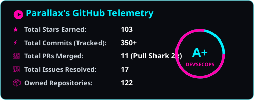
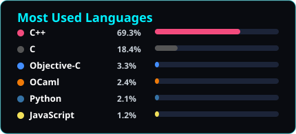

<div align="center">

<p align="center">
  <b>🌐 言語を選択 / Select Language:</b><br/>
  <a href="./README.md"></a>
  <a href="./README.es.md"></a>
  <a href="./README.pt.md"></a>
  <a href="./README.ja.md"></a>
  <a href="./README.de.md"></a>
  <a href="./README.fr.md"></a>
  <a href="./README.zh.md"></a>
  <a href="./README.ru.md"></a>
</p>


# `equisde` // ロドリゴ・カラスコ (Parallax)


<p align="center">
  <a href="https://itsparallax.me"></a>
  <a href="https://kisawea.net"></a>
  <a href="https://github.com/equisde"></a>
  <a href="https://itsparallax.me"></a>
</p>


</div>

```text
┌─ システムテレメトリ ＆ アーキテクトプロファイル ───────────────────────────┐
│ 👤 本人        : ロドリゴ・カラスコ · Parallax (equisde)                    │
│ 🎯 役割        : シニアソフトウェアエンジニア · DevSecOps / セキュリティ研究│
│ 🔬 専門領域    : 計算機科学 · 分散システムアーキテクチャ                    │
│ ⚡ 開発歴      : 2004年（11歳）よりコード執筆 · 2006年よりリバース解析      │
│ 🛡️ 中核強み    : オフェンシブセキュリティ · 破壊的QA · 耐障害性バックエンド │
│ 🤝 盟友        : @IMXNOOBX (cs2-esp, fstick, SAB, ボット開発 & 防御ツール)  │
│ 🌐 就労範囲    : 100% グローバル対応 // 完全リモートワーク可能              │
│ 🎮 連絡先      : Parallax#1526 (Discord)                                    │
└────────────────────────────────────────────────────────────────────────────┘
```

> *「私の専門は理想的な環境下でコードが動作するか確認することではなく、業務ロジックを極限の改ざんシナリオに晒し、真に破壊不可能な堅牢バックエンドアーキテクチャを保証することです。」*

---

### 🛡️ エンジニアリング哲学 ＆ コア技術領域

<details open>
<summary><b>⚔️ オフェンシブセキュリティ、モバイル解析 ＆ 破壊的QA</b> <i>(クリックして展開/折りたたみ)</i></summary>
<br/>

- **業務ロジック脆弱性の特定・検証**:
  - フィンテック決済ゲートウェイや非同期データ照合エンジンにおける複雑な**業務ロジックの欠陥 (Business Logic Flaws)**、パラメータ改ざん、IDOR、競合状態 (Race Conditions)、クライアントサイド制御バイパスの体系的検出と堅牢化。
- **モバイルリバースエンジニアリング ＆ 動的フック**:
  - Android ネイティブバイナリ解析、**Frida** による実行時動的フック、Dalvik/ART ランタイム実行追跡、**Il2CppDumper**、Magisk (`cert-fixer`) を用いたルート証明書信頼注入。
  - プロトコルリバースエンジニアリング: **Burp Suite Professional**、**Fiddler Everywhere** 独自自動バイトコードパッチ、Nuclei、Shodan、ADB、Scrcpy。
- **分散型敵対的テストパイプライン**:
  - **3proxy** クラスタによる動的 IP ローテーション、一時的認証セッションの自動生成、ファジングとペイロード大量注入テスト。
- **物理セキュリティ ＆ 非接触通信監査**:
  - 高周波/低周波 RFID および NFC プロトコル解析・複製検証 (**Mifare Classic**)。
</details>

<br/>

<details open>
<summary><b>🏢 エンタープライズシステム、ブロックチェーン ＆ 自律デーモン</b> <i>(クリックして展開/折りたたみ)</i></summary>
<br/>

- **Saargo Spa (企業実績)**:
  - PHP 8.3、Microsoft SQL Server、Python を基盤とした全社 ERP コアアーキテクチャの設計および開発。
  - ミッションクリティカルな高スループット決済エンジン、基幹業務プロセスの自動オーケストレーション。
- **ブロックチェーン草創期の開拓**:
  - アルトコインブーム初期の **Foxycoin** アーキテクト。P2P コンセンサス設計、ネットワークデーモンの運用とコンパイル、デスクトップウォレット開発、Bitcointalk でのローンチ。
  - CryptoNote をベースとした分散型プライバシープロトコルの実装およびセキュリティ監査。
- **常駐自律デーモン ＆ リアルタイム通信**:
  - 耐障害性に優れたクラウド同期エンジン、非同期イベント処理システム (Radar)、高可用性 cron 基盤、**Go**、**Python (Flask/FastAPI)**、**Node.js (Socket.IO, Baileys/WhatsApp)**、**PHP 8.3**、**C# (.NET)** によるマイクロサービス群。
- **2D/3D ウェブグラフィックス計算**:
  - **Three.js**（カノニカル v52 パーカーモデルと解剖学的デカールマッピング）および **Fabric.js** を駆使したリアルタイム CAD / EC 向け 3D 製品キャリブレータ。Nginx / PHP-FPM / Linux 上で高効率稼働。
</details>

<br/>

<details open>
<summary><b>☁️ クラウド、DevSecOps、低レイヤーフォレンジック ＆ IoTノード</b> <i>(クリックして展開/折りたたみ)</i></summary>
<br/>

- **クラウド ＆ DevSecOps インフラ**:
  - **Google Cloud Platform (GCP Spot VMs, 固定IPルーティング)**、Cloudflare WAF / Zero Trust、New Relic フルスタック監視、GPU クラウド基盤 (Lightning AI, Thunder Compute) のエージェントCLI統合。
- **ハードウェア ＆ エッジ IoT ノード**:
  - ESP32-U マイクロコントローラによる自律型エッジセンサー（Bluetooth A2DP ストリーミング、Wi-Fi ポーリング）、ドローンフライトコントローラのテレメトリ、高速 3D プリンタサーバ (Klipper / OctoPrint)。
- **低レイヤーストレージフォレンジック**:
  - TestDisk を活用した、1.8 TB 以上の破損ストレージにおける手動 MBR/GPT パーティション復元と論理セクタ救出。Google Play Console（**Tribilin Devs**）でのアプリ公開、OpenStreetMap での地図データ監査。
</details>

---

### 🤝 最重要 VIP パートナー ＆ 盟友: [IMXNOOBX](https://github.com/IMXNOOBX)

<div align="center">

<table style="border: 2px solid #00f0ff; border-radius: 14px; background: #090b10;">
<tr>
<td width="140" align="center" valign="middle">
  <a href="https://github.com/IMXNOOBX">
    
  </a>
  <br/><br/>
  <a href="https://github.com/IMXNOOBX"><b><font color="#00f0ff" size="4">@IMXNOOBX</font></b></a>
  <br/>
  <sub><a href="https://noob.pm"><b><font color="#ff00aa">🌐 noob.pm</font></b></a></sub>
</td>
<td valign="middle" align="left">
  <h3>⚡ <a href="https://github.com/IMXNOOBX"><font color="#00f0ff">IMXNOOBX</font></a> — 核心的盟友 · 防御エンジニア ＆ リバース解析専門家</h3>
  <p>
    <a href="https://github.com/IMXNOOBX"></a>
    
    
  </p>
  <p>
    <b>メモリ解析、ゲームセキュリティ研究、ハードウェアハッキング、自律防御ツール開発における不可欠な盟友。</b>
  </p>
  <p>
    <b>⭐ IMXNOOBX の代表的リポジトリ・兵器:</b>
    <ul>
      <li>🎮 <b><a href="https://github.com/IMXNOOBX/cs2-external-esp">cs2-external-esp</a></b> (608★): 高性能 C++ 外部メモリフレームワーク ＆ ESP エンジン。</li>
      <li>📟 <b><a href="https://github.com/IMXNOOBX/fstick">fstick</a></b> (79★): M5StickC Plus (ESP32-PICO) 向け無線ペネトレーションツールキット。</li>
      <li>🛡️ <b><a href="https://github.com/IMXNOOBX/SAB">SAB (SimpleAntiBot)</a></b>: ボット襲来およびスパム攻撃に対する Kotlin 製サーバー防御プラグイン。</li>
      <li>🧩 <b><a href="https://github.com/IMXNOOBX/vencord-signature">Vencord プラグイン群</a></b> ＆ <b><a href="https://github.com/IMXNOOBX/autoVoiceProtect">autoVoiceProtect</a></b>: Discord クライアント拡張と自動保護機能。</li>
      <li>🤖 <b>Discord &amp; Steam 高速ボット設計</b>: Node.js による耐攻撃性ボット開発。<i>ボット開発の依頼は <a href="https://github.com/IMXNOOBX"><font color="#00f0ff">彼にコンタクト</font></a>!</i></li>
    </ul>
  </p>
  <blockquote>
    <i>"This is my first project in python. Its a simple advanced readme generator for your projects. Tnx to @equisde (Parallax) for helping me in my noobie mistakes :D"</i> — <b>IMXNOOBX (<a href="https://github.com/IMXNOOBX/readme-generator">readme-generator</a>)</b>
  </blockquote>
  <p>
    👉 <a href="https://github.com/IMXNOOBX"><b><font color="#00f0ff">↗ GitHub で @IMXNOOBX とリンクする</font></b></a> &nbsp;|&nbsp; 🌐 <a href="https://noob.pm"><b><font color="#ff00aa">公式ノード: noob.pm ↗</font></b></a>
  </p>
</td>
</tr>
</table>

</div>

---

### 🏆 GitHub プロファイル実績・バッジ

<div align="center">

| 🧠 Galaxy Brain | 🎯 Quickdraw | 🦈 Pull Shark (2x) | 🎲 YOLO | ❄️ Arctic Vault |
| :---: | :---: | :---: | :---: | :---: |
| Q&A解決アンサー採択 | 5分以内でのIssue解決 | 19件以上のPRマージ | 本番ブランチへの直接反映 | 2020年北極コード保管庫収録 |

</div>

---

### 💻 技術スタック ＆ 開発言語

<div align="center">

#### コア言語 ＆ ランタイム
<p align="center">
  
  
  
  
  
  
  
  
</p>

#### セキュリティ、リバース ＆ テストツール
<p align="center">
  
  
  
  
  
  
</p>

#### クラウド、インフラ ＆ DevSecOps
<p align="center">
  
  
  
  
  
  
</p>

</div>

---

### 📊 GitHub アクティビティ・テレメトリ (静的高速描画)

<div align="center">




<br/>


</div>

---

### 🚀 主力システム ＆ 主要リポジトリ

- 🔍 **[RoRoIntercept](https://github.com/equisde/RoRoIntercept)** — Android における透過的 HTTPS 通信の傍受、MITM プロキシ、リアルタイムペイロード書き換えフレームワーク。
- 📱 **[ControlRemotoTV-Abuelitos](https://github.com/equisde/ControlRemotoTV-Abuelitos)** — 高齢者向け Android TV アクセシビリティ IP リモートコントロール。
- 🛠️ **[Fiddler Everywhere Tools](https://github.com/equisde/fiddler-everywhere-patch-automated)** — 企業向けネットワーク解析のための自動バイトコードパッチおよび動的解析スイート。
- 🤖 **[YuyinODS](https://github.com/equisde/YuyinODS)** — ローカル分散型 AI サーバインフラ、自律型エージェントパイプライン、マルチモーダル推論。
- ⚙️ **基幹 ERP コア (Saargo Spa)** — 高スループットかつ耐障害性に優れた商用トランザクションバックエンド。

---

<div align="center">

<p align="center">
  <b>🌐 他の言語バージョン:</b>
  <a href="./README.md">🇺🇸 English</a> &middot;
  <a href="./README.es.md">🇪🇸 Español</a> &middot;
  <a href="./README.pt.md">🇧🇷 Português</a> &middot;
  <a href="./README.ja.md">🇯🇵 日本語</a> &middot;
  <a href="./README.de.md">🇩🇪 Deutsch</a> &middot;
  <a href="./README.fr.md">🇫🇷 Français</a> &middot;
  <a href="./README.zh.md">🇨🇳 中文</a> &middot;
  <a href="./README.ru.md">🇷🇺 Русский</a>
</p>


`// Parallax (Rodrigo Carrasco) · プリンシパル DevSecOps アーキテクト · 決して倒れない堅牢システムを創造する`

<!-- IMXNOOBX (https://github.com/IMXNOOBX) との協働同盟により維持管理 -->

</div>
